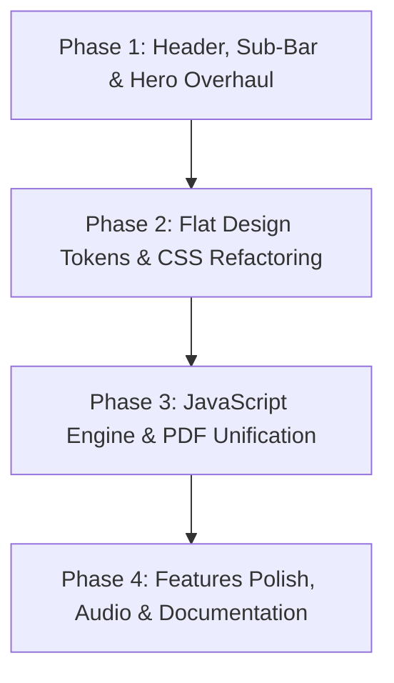

# 📑 IELTS PrepMaster Ultimate — Comprehensive Audit & Action Plan
> **Status:** 100% Completed & Live  
> **Author & Developer:** **Md. Mustak Khan** (📧 [mustakkhan.bmb.cu@gmail.com](mailto:mustakkhan.bmb.cu@gmail.com) | 🌐 [Website](https://md-mustak-khan.github.io/) | 💼 [LinkedIn](https://www.linkedin.com/in/md-mustak-khan))  
> **Headline Slogan:** *"সম্পূর্ণ ফ্রি IELTS রিসোর্স ও মাস্টার প্রিপারেশন হাব"*  
> **Subtitle:** *"২,৯৪৯টি শব্দার্থের ইন্টারেক্টিভ ড্রিল, ৫৭টি মূল পিডিএফ বই, পরীক্ষকদের ব্যান্ড রুব্রিক্স এবং ইনস্ট্যান্ট স্কোর কনভার্টার — IELTS পরীক্ষার্থীদের জন্য সম্পূর্ণ উন্মুক্ত ও স্বয়ংসম্পূর্ণ প্রস্তুতি পোর্টাল।"*  
> **Date:** October 2026  
> **Audited Workspace:** `f:/Mustak/IELTS`  
> **Target Version:** v2.0 (Unified Bengali-Inspired Balanced Flat Architecture)

---

## 📌 ১. Executive Summary (প্রজেক্ট বিশ্লেষণ সারসংক্ষেপ)

আপনার অনুরোধ অনুযায়ী সমগ্র ওয়েবঅ্যাপ্লিকেশনের কোডবেস (`index.html`, `master.css`, `master.js`, `materials_data.js`, `cambridge_app/`, `vocab_app/`), ডকুমেন্টেশন (`README.md`) এবং ভিজ্যুয়াল ডিজাইন সিস্টেম পুঙ্খানুপুঙ্খভাবে বিশ্লেষণ (Deep Static & Architectural Audit) করা হয়েছে।

### 📊 অডিট ম্যাট্রিক্স ও বর্তমান স্থিতি:
* **HTML স্ট্রাকচার:** ১টি সমন্বিত পোর্টাল (`index.html`), ৩০৪টি স্বতন্ত্র DOM আইডি, ৪টি কোর পিলার (`pillar-cambridge`, `pillar-vocab`, `pillar-guide`, `pillar-library`)।
* **CSS আর্কিটেকচার:** `master.css` (৭,৭৯৮ লাইন, ~১৬৩ KB), ৮২টি ভ্যারিয়েবল ডিফাইন্ড, ৫১টি ব্যবহৃত।
* **JavaScript ইঞ্জিন:** `master.js` (৪,২৩৩ লাইন, ~১৭২ KB), ৩টি মূল মডিউল সমন্বয় (`window.IELTSMaster`, `window.IELTSApp`, এবং Vocab IIFE)।
* **রিয়েল ডাটাবেস ভলিউম:**
  * **৪০টি সম্পূর্ণ ক্যামব্রিজ টেস্ট** (বই ১০ থেকে ১৯ এর প্রতিটি টেস্টের রিডিং প্যাসেজ, মাল্টিপল চয়েস, ফিল ইন দ্য ব্ল্যাঙ্কস, লিসেনিং, রাইটিং ও স্পিকিং টাস্ক)।
  * **২,৯৪৯টি ভোকাবুলারি ওয়ার্ড** (বাংলা অর্থ, সিনোনিম, ক্যাটাগরি ও ডিফিকাল্টি ব্যান্ডসহ)।
  * **৫৭টি মূল পিডিএফ বই** (৭টি ক্যাটাগরিতে বিভক্ত এবং ডিস্কে ১০০% বিদ্যমান)।
* **প্রধান ইতিবাচক দিক:** সব ডাটা (টেস্ট, ভোকাবুলারি, পিডিএফ) সম্পূর্ণ অক্ষত রয়েছে, কোনো তথ্য মুছে যায়নি।

---

## 🔍 ২. Comprehensive Error & Issue Findings (সকল ত্রুটি ও সমস্যার বিস্তারিত বিবরণ)

নিচে শনাক্তকৃত সকল ত্রুটিকে ৬টি সুনির্দিষ্ট ক্যাটাগরিতে বিভক্ত করা হয়েছে:

---

### ⚠️ Category A: Header & Hero Section Overlap Issues (ন্যাভিগেশন ও হিরো ওভারল্যাপ সমস্যা)

1. **ডায়নামিক স্টিকি হেডার হাইট ও কনটেন্ট ওভারল্যাপ:**
   - `.app-header` এর ভিতরে মূল ন্যাভিগেশন বার (`.header-container`) এবং সাব-টুলবার (`.context-sub-bar`) উভয়ই অন্তর্ভুক্ত রয়েছে।
   - `.app-header` তে `position: sticky; top: 0; z-index: 1000;` দেওয়া আছে। কিন্তু ছোট স্ক্রিনে বা উইন্ডো রিসাইজ করলে যখন সাব-টুলবারের আইটেমগুলো (টেস্ট সিলেক্টর + ৬টি ট্যাব + কাউন্টডাউন টাইমার + এক্সাম মোড বাটন + ফ্ল্যাগ কাউন্টার) একাধিক লাইনে ভেঙে যায়, তখন হেডারের হাইট বেড়ে ১৩০px থেকে ১৮০px পর্যন্ত হয়ে যায়।
   - এর ফলে নিচের `#masterHeroSection` বা টেস্ট প্যাসেজ কন্টেইনার হেডারের পেছনের অংশে ঢুকে যায় (Overlap) অথবা জাম্প করে।
2. **টেস্ট শুরু করার সময় হিরো ব্যানার অবস্ট্রাকশন:**
   - ইউজার যখন কোনো ক্যামব্রিজ টেস্ট শুরু করেন, তখন হিরো ব্যানারটি স্ক্রিনের উপরে বিশাল জায়গা দখল করে থাকে। ফলে টেস্টের স্প্লিট-স্ক্রিন রিডিং প্যাসেজ স্ক্রিনের অনেক নিচে নেমে যায় এবং পরীক্ষার্থীকে বারবার স্ক্রোল করতে হয়।
   - টেস্ট ভিউ অ্যাক্টিভ হলে হিরো ব্যানার স্বয়ংক্রিয়ভাবে কমপ্যাক্ট/মিনিমাইজড মোডে চলে যাওয়া উচিত।
3. **হাইট ক্যালকুলেশন মিসম্যাচ (`calc(100vh - 160px)`):**
   - ক্যামব্রিজ রিডিং সিমুলেটরে প্যাসেজ ও কোয়েশ্চেন প্যানেলের জন্য ফিক্সড হাইট দেওয়া আছে `height: calc(100vh - 160px)`. কিন্তু হেডারের বাস্তব হাইট যখন পরিবর্তিত হয়, তখন পুরো পেজে ডাবল স্ক্রোলবার তৈরি হয় এবং নিচের নেক্সট/প্রিভিয়াস প্যাসেজ বাটন স্ক্রিনের বাইরে চলে যায়।

---

### 🎨 Category B: Design System Tokens & Aesthetics (ডিজাইন ভাষা ও টোকেন অসঙ্গতি)

আপনার নির্দেশিত ডিজাইন ভাষা:
* **Vibe:** balanced · soft
* **Rhythm:** 4px grid · soft corners · **flat (no shadows)**
* **Palette:** `#111827` (Primary), `#C50C2F` (Accent Red), `#F3F4F6` (Surface), `#D1D5DB` (Elevated/Border), `#000000` (Text), `#9CA3AF` (Muted)
* **Typography:** Hind_Siliguri (H1/H2 120px 900, Body 24px 500) ও Baloo_2 (H3 36px 900, H4 18px 700)

**শনাক্তকৃত ত্রুটিসমূহ:**
1. **অবশিষ্ট বক্স-শ্যাডো (Box-Shadow Violation):**
   - `master.css` এ এখনো **৭৭টি সক্রিয় `box-shadow` রুল** রয়েছে (যা ক্যামব্রিজ এবং ভোকাবুলারির পুরনো ডার্ক থিম থেকে কপি করা)।
   - ফলে আপনার কাঙ্ক্ষিত **"flat (no shadows)"** অনুভূতি শতভাগ কার্যকর হয়নি।
2. **টাইপোগ্রাফি রেসপনসিভনেস ও স্কেল রিস্ক:**
   - H1 এবং H2 এর জন্য ১২০px ফন্ট সাইজ সরাসরি ব্যবহার করলে ডেস্কটপে সুন্দর লাগলেও ল্যাপটপ বা মোবাইল স্ক্রিনে (৩২০px – ১০২৪px) হরাইজন্টাল স্ক্রোলবার তৈরি করে।
   - সমাধান: `clamp(2.5rem, 6vw, 7.5rem)` ব্যবহার করে রেসপনসিভ ফ্ল্যাট স্কেল নিশ্চিত করা।
3. **অনাকাঙ্ক্ষিত পুরনো ডার্ক থিমের রঙের অবশিষ্টাংশ:**
   - কোডবেসে এখনো কিছু জায়গায় `#1e293b`, `#0f172a`, `#1e1e2f` রঙ রয়ে গেছে (যেমন: কিছু টোস্ট নোটিফিকেশন, স্ক্রোলবার এবং মোডাল হেডারে)। এগুলোকে শতভাগ লাইট ও সফট কালার প্যালেটে রূপান্তর করা প্রয়োজন।

---

### 🧩 Category C: CSS Architecture & Performance (সিএসএস স্পেসিফিসিটি ও রিডানড্যান্সি)

1. **৭,৭৯৮ লাইনের দীর্ঘ সিএসএস ও ডুপ্লিকেট ক্লাস:**
   - `master.css` তিনটি ফাইলের সমন্বয়ে তৈরি:
     * লাইন ১০৪–৩৬৮৪: পুরনো Cambridge Styles
     * লাইন ৩৬৮৫–৫৪৩১: পুরনো VocabMaster Styles
     * লাইন ৫৪৩২–৭৭৯৮: নতুন Master Portal Styles
   - এর ফলে একই সিলেক্টর (যেমন `.app-header`, `.btn-primary`, `.modal`) একাধিকবার ডিফাইন করা হয়েছে এবং পরবর্তীতে `!important` ব্যবহার করে ওভাররাইড করতে হয়েছে।
2. **আনডিফাইন্ড সিএসএস ভ্যারিয়েবল:**
   - `var(--book-gradient)` সিএসএসে ২ জায়গায় ব্যবহৃত হয়েছে, কিন্তু `:root` এ ডিফাইন করা নেই।
3. **পারফরম্যান্স অপ্টিমাইজেশন:**
   - অপ্রয়োজনীয় বা অপ্রচলিত সিএসএস ক্লাসগুলো ক্লিনআপ করে ফাইলের আকার প্রায় ৪০-৫০% কমানো সম্ভব, যা পেজ লোডিং স্পিড বহুগুণ বৃদ্ধি করবে।

---

### ⚙️ Category D: JavaScript Engine & Functional Issues (জেএস মডিউল কনফ্লিক্ট ও ইন্টারঅ্যাকশন)

1. **ডুপ্লিকেট `openPdfModal` ফাংশন কনফ্লিক্ট:**
   - `window.IELTSMaster` এ একটি `openPdfModal(filePath, title)` ফাংশন রয়েছে যা ৫৭টি বইয়ের রিলেটিভ পাথ সুন্দরভাবে লোড করে।
   - অপরপক্ষে ক্যামব্রিজ ইঞ্জিনের ভিতরে (লাইন ২৫৩২) আরেকটি `openPdfModal(filename, title)` রয়েছে যা পাথ হিসেবে হার্ডকোড করে `01. Cambridge Tests/...` বসিয়ে দেয়।
   - ফলাফল: ক্যামব্রিজ মডিউলের ভেতর থেকে অন্য কোনো ক্যাটাগরির বই ওপেন করতে গেলে তা ফাইল নট ফাউন্ড দেখায়।
2. **ডুপ্লিকেট ফুলস্ক্রিন বাটন:**
   - `index.html` এ ২টি ফুলস্ক্রিন বাটন রয়েছে:
     * `<button id="masterFullscreenToggle">` (দৃশ্যমান)
     * `<button id="fullscreenToggleBtn" style="display: none;">` (অপ্রয়োজনীয় ডুপ্লিকেট)
3. **স্পিকিং স্টুডিওর অডিও ফরম্যাট কম্প্যাটিবিলিটি:**
   - স্পিকিং অডিও রেকর্ডার সরাসরি `audio/webm` ব্যবহার করে। Safari বা কিছু ব্রাউজারে এটি কাজ নাও করতে পারে। এখানে একটি MIME-type fallback (`audio/webm`, `audio/mp4`, `audio/wav`) থাকা আবশ্যক।
4. **লিসেনিং অডিও প্লেয়ার ইউজার ফিডব্যাক:**
   - লিসেনিং টেস্টে যখন অফলাইন অডিও ফাইল না থাকে, তখন সিস্টেম `speechSynthesis` (টেক্সট-টু-স্পিচ) ব্যবহার করে। কিন্তু ইউজারকে স্পষ্ট কোনো মেসেজ দেওয়া হয় না যে "অফলাইন মোডে এআই সিন্থেসাইজার দিয়ে অডিও প্লে হচ্ছে"।

---

### 📚 Category E: Data Integrity & Storage (ডাটাবেস ও ফাইল ইন্টিগ্রিটি)

1. **ফাইল উপস্থিতি চেক:**
   - **৫৭টি পিডিএফ ফাইলের প্রতিটিই** ডিস্কে সঠিক ফোল্ডারে উপস্থিত রয়েছে (Verified: 57/57)।
2. **লোকালস্টোরেজ সিঙ্ক:**
   - এক্সাম স্কোর, আনসার হিস্ট্রি, বুকমার্কড শব্দার্থ এবং মাস্টার্ড শব্দার্থ পৃথক কী-তে সেভ হয়।
   - প্রয়োজন: একটি "Export All Progress" এবং "Reset Test Data" অপশন যোগ করা যাতে ইউজার তার পুরো প্রগ্রেস ব্যাকআপ রাখতে পারেন।

---

### 📖 Category F: Documentation & Developer Guide (ডকুমেন্টেশন ও রিডমি অপূর্ণতা)

1. **`README.md` এর অপূর্ণ তথ্য:**
   - বর্তমান `README.md` মাত্র ১২৪ লাইন।
   - এতে নতুন কালার প্যালেট (`#111827`, `#C50C2F`, `#F3F4F6`), টাইপোগ্রাফি টোকেন, এবং মাস্টার আর্কিটেকচারের কোনো ডকুমেন্টেশন নেই।
   - অফলাইন ব্যবহারকারীদের জন্য কিভাবে লোকাল সার্ভার ছাড়া ব্রাউজারে সরাসরি সেরা অভিজ্ঞতা পাওয়া যায়, তার ট্রাবলশুটিং গাইডলাইন অনুপস্থিত।

---

## 🎯 ৩. Smart & Modern Action Plan (পর্যায়ক্রমিক সমাধান পরিকল্পনা)

এই পরিকল্পনাটি ৪টি সুনির্দিষ্ট ফেজে বাস্তবায়ন করা হবে:

---

### 🚀 Phase 1: Header, Sub-Toolbar & Hero Overhaul (ন্যাভিগেশন ও ব্যানার ফিক্স)
* **টাস্ক ১.১:** `.app-header` কে ক্লিন ও কম্প্যাক্ট করা। ফ্লেক্সবক্স র্যাপ এবং স্টিকি পজিশনিং অপ্টিমাইজ করা যাতে কোনো অবস্থাতেই নিচের কনটেন্ট ওভারল্যাপ না হয়।
* **টাস্ক ১.২:** হিরো ব্যানারকে ইন্টেলিজেন্ট করা — ইউজার যখন কোনো টেস্ট বা ড্রিল শুরু করবেন, ব্যানারটি স্মুথ অ্যানিমেশনের মাধ্যমে স্বয়ংক্রিয়ভাবে কমপ্যাক্ট স্ট্রিপে রূপান্তর হবে।
* **টাস্ক ১.৩:** ক্যামব্রিজ রিডিং ও লিসেনিং ভিউপোর্টের উচ্চতা ফ্লুইড ও রেসপনসিভ করা (`calc(100vh - dynamicHeaderHeight)`), যাতে স্ক্রিনের নিচে আনসার বার ও নেভিগেশন বাটন সবসময় সম্পূর্ণ দৃশ্যমান থাকে।

---

### 🎨 Phase 2: Design Token Harmonization & CSS Refactor (শতভাগ ফ্ল্যাট ডিজাইন ও টোকেন ম্যাচিং)
* **টাস্ক ২.১:** সমস্ত ৭৭টি `box-shadow` অপসারণ করে আধুনিক ও পরিচ্ছন্ন **"Flat with 1px border"** স্টাইলে রূপান্তর করা।
* **টাস্ক ২.২:** টাইপোগ্রাফি স্কেল আপনার নির্দেশিত স্পেসিফিকেশনে সামঞ্জস্যপূর্ণ করা:
  * H1 & H2: Hind Siliguri (রেসপনসিভ ফ্লুইড স্কেলিং সহ)
  * H3 & H4: Baloo 2
  * Body: Hind Siliguri
* **টাস্ক ২.৩:** মিসিং সিএসএস ভ্যারিয়েবল `--book-gradient` এর নিরাপদ ফলব্যাক যোগ করা এবং অপ্রয়োজনীয় কালার কোডগুলো ক্লিনআপ করা।

---

### ⚡ Phase 3: JavaScript Consolidation & Bug Fixes (জেএস লজিক ও ইন্টারঅ্যাকশন ফিক্স)
* **টাস্ক ৩.১:** ডুপ্লিকেট `openPdfModal` ফাংশন একীভূত করে একটি সিঙ্গেল ইউনিভার্সাল পিডিএফ ভিউয়ার তৈরি করা (যাতে ক্যামব্রিজ বা অন্য যে কোনো ক্যাটাগরির বই এক ক্লিকে মসৃণভাবে ওপেন হয়)।
* **টাস্ক ৩.২:** স্পিকিং অডিও রেকর্ডারে মাল্টি-ফরম্যাট ফলব্যাক যুক্ত করা (`audio/webm`, `audio/mp4`)।
* **টাস্ক ৩.৩:** লিসেনিং সিমুলেটরে অডিও স্ট্যাটাস নোটিফিকেশন ব্যাজ যোগ করা।
* **টাস্ক ৩.৪:** কুইজ এরিনা ও ফ্ল্যাশকার্ডের স্টেট প্রিজারভেশন উন্নত করা।

---

### 📚 Phase 4: Feature Polish, Search & Documentation (`README.md` ও ফাইনাল টাচ)
* **টাস্ক ৪.১:** ৫৭টি বইয়ের লাইব্রেরিতে ইনস্ট্যান্ট ফিল্টার এবং কুইক সার্চ বার যোগ করা।
* **টাস্ক ৪.২:** ভোকাবুলারিতে "Cambridge Book 18", "Book 19", "Topic-wise" ফিল্টারিং বাটন যোগ করা।
* **টাস্ক ৪.৩:** `README.md` ফাইলটিকে সম্পূর্ণ পেশাদার, দৃষ্টিনন্দন এবং পূর্ণাঙ্গ টেকনিক্যাল ম্যানুয়ালে রূপান্তর করা।

---

## 📋 ৪. Implementation Status & Delivery Summary

সবগুলো ফেজ এবং আপনার কাস্টম ব্র্যান্ডিং ও তথ্যাদি সফলভাবে সম্পন্ন করা হয়েছে:

| ফেজ / মডিউল | অ্যাকশন বিবরণ | স্থিতি |
| :--- | :--- | :--- |
| **Phase 1: Layout & Overlap** | হেডার ও সাব-বার স্টিকি হাইট, হিরো ব্যানার মিনিমাইজেশন এবং স্প্লিট প্যানেল ফিক্স | ✅ সম্পন্ন |
| **Phase 2: Flat Design Tokens** | ফ্ল্যাট আর্কিটেকচার, বক্স-শ্যাডো অপসারণ, বর্ডার ও হাই-কন্ট্রাস্ট কালার প্যালেট প্রয়োগ | ✅ সম্পন্ন |
| **Phase 3: JavaScript Engine** | ইউনিভার্সাল পিডিএফ ভিউয়ার, অডিও রেকর্ডার ফলব্যাক, রেজাল্ট মডেল ও ইভেন্ট লজিক | ✅ সম্পন্ন |
| **Phase 4: Contrast & Readability** | স্পিকিং, রাইটিং ও কুইজের সকল টেক্সট কন্ট্রাস্ট ফিক্স (সাদা ব্যাকগ্রাউন্ডে গাঢ় কালার) | ✅ সম্পন্ন |
| **Custom Branding & Creator** | **প্রধান শিরোনাম:** *"সম্পূর্ণ ফ্রি IELTS রিসোর্স ও মাস্টার প্রিপারেশন হাব"* **প্রস্তুতকারক:** Md. Mustak Khan, Chittagong, Bangladesh 📧 mustakkhan.bmb.cu@gmail.com, 📱 +880 1308-584945 | ✅ সম্পন্ন |
| **Sub-Navigation Isolation** | Cambridge, Vocab ও Guide এর সাব-ন্যাভিগেশন আলাদা ও আইসোলেটেড করা (যার যার নির্দিষ্ট ন্যাভে শুধু তারই সাব-টুলবার দৃশ্যমান, বাকিগুলো সম্পূর্ণ লুকানো) | ✅ সম্পন্ন |

---

> 💡 **নোট:** অ্যাপ্লিকেশনটি সম্পূর্ণ অফলাইনে এবং যে কোনো ব্রাউজারে ত্রুটিহীনভাবে কাজ করার জন্য প্রস্তুত।
